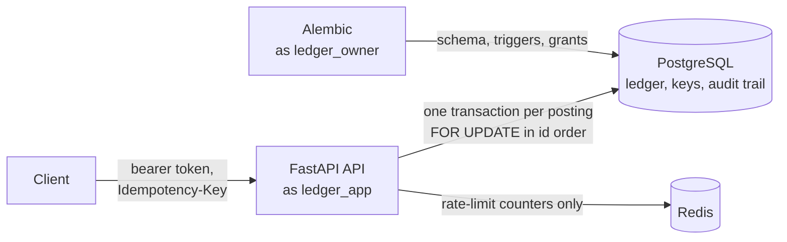

# banking-ledger-api

[](https://github.com/felzov/banking-ledger-api/actions/workflows/banking-ledger-api.yml)

A banking backend built around a double-entry ledger whose rules live in PostgreSQL: every
posting balances to zero or changes nothing, parallel transfers neither deadlock nor overdraw,
and a retried request never moves money twice.

> **Status: all ten planned phases are done.** A portfolio project that runs on one machine with
> Docker Compose. Not production-ready: no HTTPS, and credentials come from a local `.env`. All
> data is synthetic.

**Stack:** Python 3.14, FastAPI, Pydantic v2, SQLAlchemy 2 (async), PostgreSQL 18, Alembic,
Redis 8, pytest, Hypothesis, Docker Compose, GitHub Actions.

## Documentation

| Page | What it covers |
|------|----------------|
| [Ledger guarantees](banking-ledger-api/docs/ledger-guarantees.md) | Schema, database-enforced invariants, posting protocol, idempotency, statements |
| [API reference](banking-ledger-api/docs/api.md) | Routes, authentication, error codes |
| [Failure modes](banking-ledger-api/docs/failure-modes.md) | Lost `COMMIT`s, disconnects, cancellation, shutdown |
| [Security](banking-ledger-api/docs/security.md) | Passwords, tokens, rate limits, database roles |
| [Operations](banking-ledger-api/docs/operations.md) | Start-up, environment variables, backups, logs |
| [Testing](banking-ledger-api/docs/testing.md) | What each group of tests proves |
| [Known limitations](banking-ledger-api/docs/limitations.md) | What the project does not do |
| [Decisions](banking-ledger-api/docs/adr/) | Seventeen ADRs |

## Architecture



- **PostgreSQL is the source of truth** for money, idempotency keys and the audit trail. Redis
  only counts rate limits.
- **The rules are in the database**: every transaction sums to zero (checked at `COMMIT`),
  history is never updated or deleted, and no posting crosses currencies.
- **The API runs as `ledger_app`**, a role that cannot disable those rules or read the audit
  trail.

## What it guarantees

- **Integer money.** Amounts are minor units (`2500` is £25.00), never floats.
- **All or nothing.** Each deposit, withdrawal or transfer is one database transaction.
- **No overdrafts, no deadlocks.** Accounts are locked in id order; balances cannot go negative.
- **At most once per key.** Every posting needs an `Idempotency-Key`; a retry replays the
  original result.
- **Audited.** Every attempt, succeeded or rejected, is recorded in an append-only table.

## Getting started

Requires Docker with Compose, [uv](https://docs.astral.sh/uv/) and GNU Make.

```bash
cd banking-ledger-api
cp .env.example .env    # synthetic, local-only values
make install            # create .venv
make up                 # start PostgreSQL, Redis and the API on localhost:8000
make check              # lint, mypy --strict and the tests
make down               # stop; data is kept
```

## Try it

With `make up` done, register, log in and open an account:

```bash
curl -s -X POST localhost:8000/users -H 'content-type: application/json' \
  -d '{"email": "alice@example.com", "password": "correct horse battery staple"}'
# 201 {"id": "<user_id>", "email": "alice@example.com", "created_at": "…"}

curl -s -X POST localhost:8000/sessions -H 'content-type: application/json' \
  -d '{"email": "alice@example.com", "password": "correct horse battery staple"}'
# 201 {"access_token": "lt_…", "token_type": "bearer", "expires_at": "…"}

TOKEN='lt_…'; USER=<user_id>
curl -s -X POST localhost:8000/users/$USER/accounts -H 'content-type: application/json' \
  -H "Authorization: Bearer $TOKEN" -d '{"currency": "GBP"}'
# 201 {"id": "<account_id>", "currency": "GBP", "balance_minor": 0, "created_at": "…"}
```

Deposit £25.00, then send the same request again, as a client would after a timeout:

```bash
ACCOUNT=<account_id>
curl -si -X POST localhost:8000/users/$USER/accounts/$ACCOUNT/deposits \
  -H 'content-type: application/json' -H "Authorization: Bearer $TOKEN" \
  -H 'Idempotency-Key: deposit-001' -d '{"amount_minor": 2500}'
```

```http
HTTP/1.1 201 Created
location: /users/<user_id>/accounts/<account_id>/transactions/<transaction_id>

{"transaction_id":"<transaction_id>","kind":"deposit","account_id":"<account_id>",
 "amount_minor":2500,"balance_after_minor":2500,"created_at":"…"}
```

The second response is the same `201`, body and `Location`, plus `idempotent-replayed: true`;
the balance is still 2500.

Withdrawing more than the balance moves nothing:

```bash
curl -s -X POST localhost:8000/users/$USER/accounts/$ACCOUNT/withdrawals \
  -H 'content-type: application/json' -H "Authorization: Bearer $TOKEN" \
  -H 'Idempotency-Key: withdrawal-001' -d '{"amount_minor": 999999}'
# 422 {"code": "insufficient_funds", "detail": "…"}
```

See the account's history:

```bash
curl -s -H "Authorization: Bearer $TOKEN" localhost:8000/users/$USER/accounts/$ACCOUNT/statement
```

Interactive API docs: <http://localhost:8000/docs>.

## License

[MIT](LICENSE)
